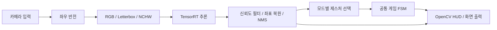
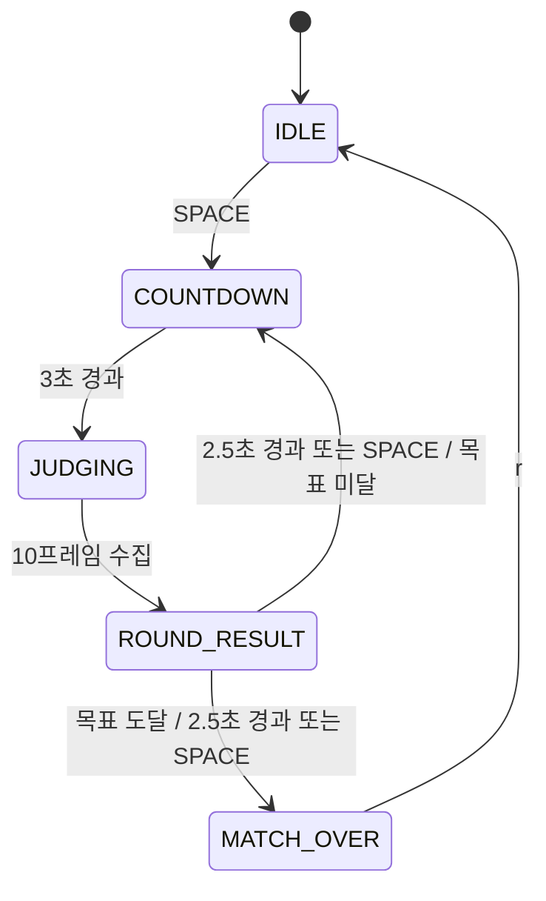

# 아키텍처와 설계 판단

[README로 돌아가기](../README.md)

## 처리 흐름

카메라 캡처부터 화면 출력까지 하나의 루프에서 순서대로 처리합니다. 별도 캡처 스레드나 프레임 큐는 없습니다.

| 모듈 | 책임 |
|---|---|
| [main.py](../main.py) | 카메라, 프레임 처리 순서, 모드 전환, 키 입력과 종료 |
| [detector.py](../core/detector.py) | 이미지 전처리, 추론 호출, 검출 결과 생성 |
| [trt_engine.py](../core/trt_engine.py) | 엔진 로드, 입출력 메모리와 CUDA Stream 관리 |
| [modes/](../game/modes/) | PvP·PvE별 플레이어 제스처 선택과 라운드 준비 |
| [state_machine.py](../game/state_machine.py) | 판정 프레임 수집, 상태 전이, 점수와 매치 관리 |
| [rules.py](../game/rules.py) | 제스처 상성 판정과 카운터 패 매핑 |
| [renderer.py](../ui/renderer.py) | 검출 박스, 카운트다운, 결과, 점수와 PC 카드 표시 |

## 추론과 메모리

1. 카메라 프레임을 좌우 반전하고 BGR에서 RGB로 변환합니다.
2. 종횡비를 유지해 Letterbox를 적용하고, 픽셀을 0~1의 float32 NCHW 텐서로 변환합니다.
3. 사전 할당한 Pinned Host 버퍼로 입력을 복사합니다.
4. 같은 CUDA Stream에서 H2D 전송 → `execute_async_v3` → D2H 전송을 요청합니다.
5. `stream.synchronize()` 후 출력 버퍼를 해석하고, 클래스별 점수의 최댓값으로 신뢰도를 필터링합니다.
6. Letterbox의 패딩과 배율을 역산해 원본 프레임 좌표로 복원한 뒤, `cv2.dnn.NMSBoxes`를 적용합니다.

입출력 전송 버퍼를 재사용해 반복적인 명시적 CUDA 메모리 할당을 피합니다. 다만 전처리·후처리의 NumPy 배열과 UI의 색상 배열은 프레임마다 생성됩니다. GPU 작업도 프레임마다 동기화하므로 여러 프레임의 전송과 추론을 겹치는 구조는 아닙니다.

엔진 출력은 재사용되는 Host 버퍼이며 다음 추론에서 덮어씁니다. 현재는 동기식 루프에서 즉시 후처리해 다음 추론 전에 소비합니다.

## 모드 선택과 공통 FSM

PvP는 반전된 화면의 바운딩 박스 중심 X 좌표를 기준으로 좌우를 나누고, 각 영역의 최고 신뢰도 검출을 선택합니다. 플레이어를 구분하는 기준은 화면 내 위치이며, 사람 ID를 추적하지 않습니다.

PvE는 전체 화면의 최고 신뢰도 검출을 사용자 패로 선택합니다. Normal은 라운드 시작 시 PC 패를 정하고, God Mode는 판정 프레임마다 인식한 사용자 패에 대한 카운터를 생성합니다. 학습 모델은 손 제스처 탐지에 사용되며, PC의 패 선택은 규칙 기반입니다.

도표의 시간과 프레임 수는 기본 설정값입니다. `r`은 어느 상태에서든 현재 매치를 초기화합니다. 모드 키도 선택한 모드의 매치를 초기화합니다. 목표 점수에 도달하면 결과 표시 시간이 지난 뒤 매치를 종료하며, 결과 화면에서 SPACE를 누르면 즉시 매치 종료 상태로 전환합니다.

수동 시작과 자동 다음 라운드는 같은 FSM의 `start_round()`를 통과합니다. 이때 모드별 준비 콜백을 호출하므로 PvE Normal의 PC 패도 매 라운드 새로 선택됩니다. 기본 목표는 먼저 3승이며, 무승부·무효 라운드가 있어 총 라운드 수는 고정되어 있지 않습니다.

## 최빈값 판정의 선택과 한계

판정 상태에 진입한 뒤 10프레임을 수집하고 각 플레이어의 패를 독립적으로 결정합니다. 라운드마다 수집 구간을 새로 시작하므로 이전 라운드의 관측이 섞이지 않습니다. 수집에 걸리는 시간은 실제 처리 프레임률에 따라 달라집니다.

- `Gesture.NONE`은 최빈값 집계에서 제외합니다.
- 어느 한 플레이어라도 수집한 10프레임이 모두 미검출이면 무효 라운드이며 점수는 증가하지 않습니다.
- 동률이면 유효 버퍼에서 먼저 등장한 제스처가 선택됩니다.
- 최소 유효 프레임 수나 과반수 조건은 없습니다. 한 프레임만 유효해도 채택됩니다.
- God Mode에서도 미검출 프레임의 PC 기본 패와 독립 집계 때문에 최종 승리를 항상 보장하지 않습니다.

## HUD 리소스

[docs/assets/](assets/)의 `paper.png`, `rock.png`, `scissors.png`를 초기화 시 읽습니다. 경로는 현재 작업 디렉터리가 아닌 렌더러 파일 위치를 기준으로 계산합니다. 아이콘이 없으면 텍스트 카드로 대체합니다.

오버레이는 프레임의 ROI에 `cv2.addWeighted`로 적용합니다. 전체 프레임 복사를 줄이는 선택이지만, ROI 크기의 색상 배열과 아이콘 리사이즈·알파 계산은 별도 메모리를 사용합니다.
